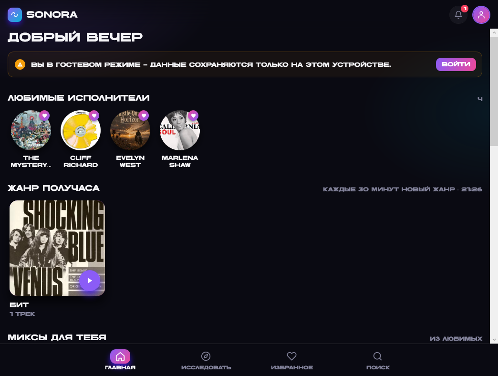
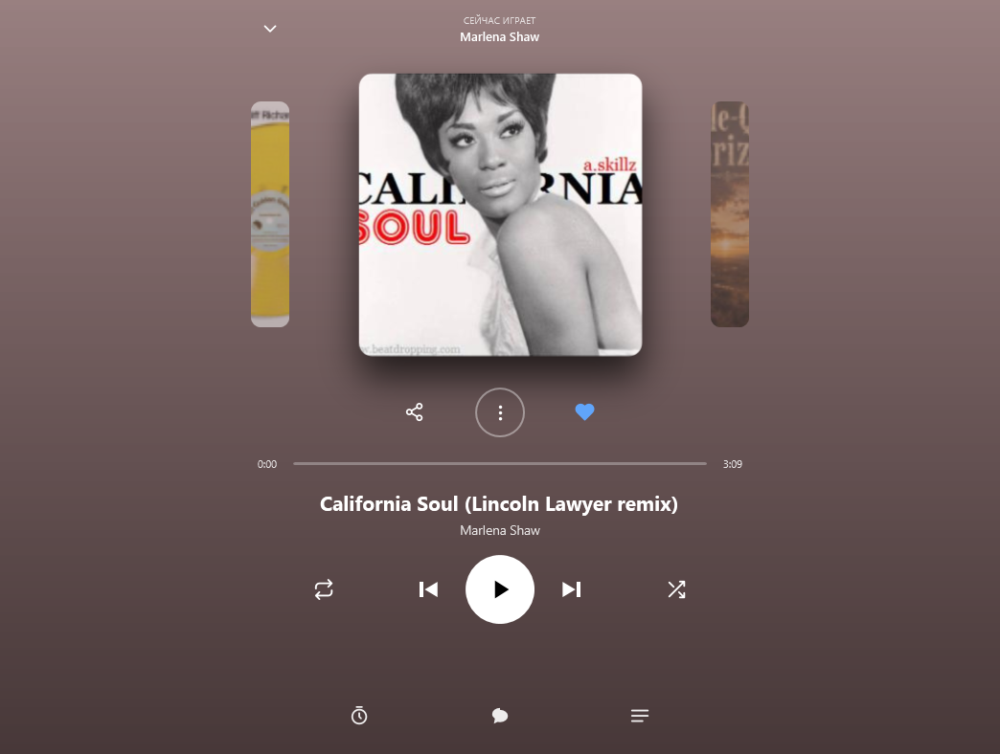
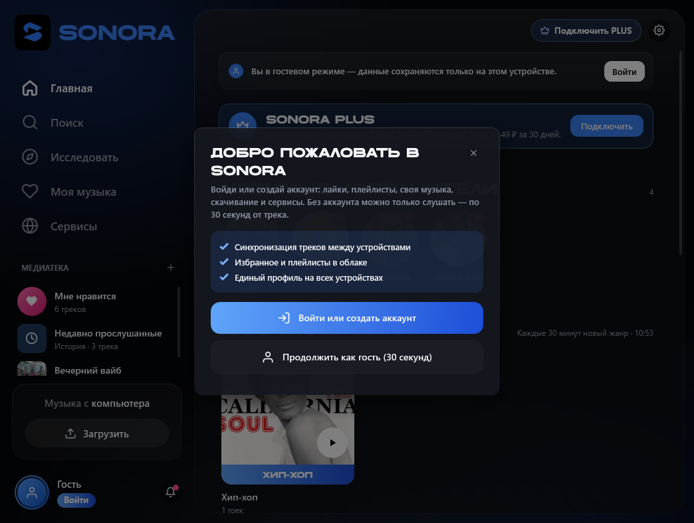
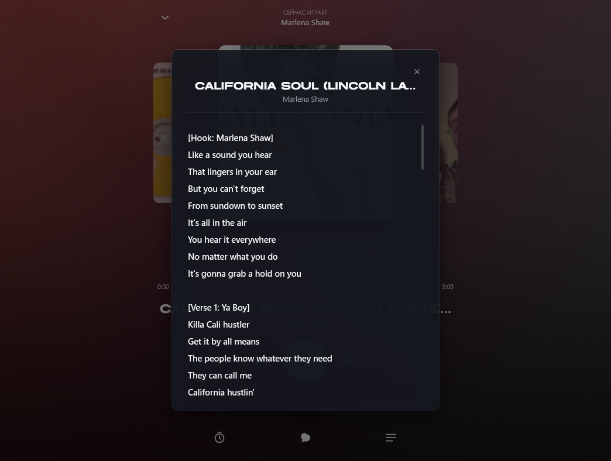

# SONORA

Нативный музыкальный плеер для Windows (C# / WPF, .NET Framework 4.8) в стиле Sonic Wave.

## Скачать

**[⬇ Скачать SONORA для Windows](https://github.com/drugalochek/DRUGA-MUSIC/releases/latest/download/SONORA-win.zip)**

Распакуй архив и запусти `SONORA.exe`. Установка не нужна: .NET Framework 4.8 уже встроен в Windows 10 и 11.
Если SmartScreen покажет предупреждение — «Подробнее» → «Выполнить в любом случае» (exe не подписан сертификатом).

## Возможности

- Дизайн Sonic Wave: тёмная тема, фиолетово-розовые градиенты, шрифт Widock, нижняя навигация
- Главная: приветствие, любимые исполнители, «Жанр получаса», «Миксы для тебя», «100% для вас», новинки
- Исследовать (Все / Недавние / Долгие / Короткие / Случайно), Избранное, Поиск, страницы артистов и плейлистов
- Плеер: мини-плеер в цветах обложки с «жидким» переливающимся фоном и свечением в такт музыке (раскрывается в полный плеер по клику на обложку/название или кнопкой ⤢), полноэкранный плеер с цветом обложки, перемотка, повтор, перемешивание, очередь, таймер сна, текст песни с караоке-подсветкой (LRC)
- Системный плеер Windows: медиа-клавиши ⏯ ⏭ ⏮, всплывающая панель громкости Windows, кнопки на миниатюре в панели задач, открытие аудиофайлов двойным кликом («Сделать SONORA плеером по умолчанию» в настройках)
- Настройки: язык (русский / English), живой фон, свечение под бит, кэш, папка данных
- Скачивание треков для офлайна и «Поделиться ссылкой» (ссылки совместимы с Sonic Wave, вставка ссылки в поиск открывает трек)
- Гостевой режим: только прослушивание по 30 секунд; лайки, плейлисты, загрузка и скачивание — после входа
- Проверка загружаемых файлов: формат, длительность, тишина, дубликаты, голосовые записи
- Свои плейлисты, любимые треки и исполнители, история прослушивания
- Загрузка своих файлов (MP3, M4A, WAV, FLAC, OGG…) — кнопкой или перетаскиванием в окно
- Вход и регистрация через Firebase: email + пароль, Google, сброс пароля, гостевой режим
- Облачная синхронизация избранного и плейлистов между устройствами
- Горячие клавиши: Пробел — пауза, ←/→ — перемотка, Ctrl+←/→ — трек, Ctrl+F — поиск, Esc — назад; колесо мыши в плеере — громкость

## Скриншоты

Скриншоты в папке [`screenshots/`](screenshots) делает само приложение (`SONORA.exe --shots <папка>`) при каждой сборке на GitHub Actions.

 
 

## Сборка

```
dotnet build Sonora/Sonora.csproj -c Release
```

Готовый файл: `Sonora/bin/Release/net48/SONORA.exe`. Данные пользователя хранятся в `%LocalAppData%\SONORA`.

## Как подключить сервисы (вкладка «Сервисы»)

- **Яндекс Музыка** — «Подключить» → SONORA покажет код и откроет ya.ru/device. Войди в Яндекс, вставь код (он уже скопирован) — подключение завершится само.
- **Spotify** — нужен свой бесплатный Client ID: developer.spotify.com/dashboard → Create app → Redirect URI `http://127.0.0.1:43117/callback` → Web API → Save → скопировать Client ID в SONORA → «Войти через Spotify».
- **Deezer** — поиск работает без входа (отрывки по 30 с). Для лайков и плейлистов вставь ссылку на свой публичный профиль `deezer.com/profile/…`.

## Вход через Google

«Войти через Google» открывает в браузере страницу SONORA на `localhost` → кнопка «Войти через Google» → выбрать аккаунт → вернуться в приложение.

## Публикация своих треков (один раз включить на сервере)

Опубликованные треки хранятся в базе SONORA (`sonora-ab012`) в разделе `catalog`: читать могут все, писать и удалять — только автор трека.
Чтобы публикация заработала, правила базы нужно обновить один раз:

1. Открой [Firebase Console](https://console.firebase.google.com/project/sonora-ab012/database/sonora-ab012-default-rtdb/rules) → Realtime Database → **Rules**.
2. Замени текст правил содержимым файла [`database.rules.json`](database.rules.json) и нажми **Publish**.

Правила сохраняют доступ к синхронизации (`users/<uid>`), как и раньше.

## SONORA Plus (оплата через ЮMoney)

49 ₽ за 30 дней, картой, кошельком ЮMoney или по QR-коду: кнопка PLUS вверху экрана или «Профиль → SONORA Plus». Plus включается автоматически после оплаты.
Сервер, который принимает уведомления ЮMoney, лежит в [`server/`](server/) — инструкция по запуску на Cloudflare Workers в [`server/README.md`](server/README.md).
